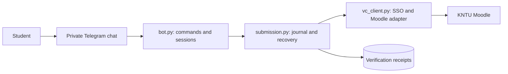

# KNTU VC Bot

[](https://github.com/AmirDVL/kntu-vc-bot/actions/workflows/tests.yml)

Find university assignments, download their files, and submit homework from Telegram—with a separate check that Moodle actually stored the intended bytes and reports the homework as submitted.

Built for a personal workflow at K. N. Toosi University of Technology: repeatedly opening course pages to find due work and upload homework. Each Telegram user connects their own university account.

**Status: working prototype.** Live sign-in, calendar discovery, attachment downloads and submission-rule parsing have been checked. Upload/final-submission recovery is tested against simulated failures; a live submission test on a disposable assignment is still required. There are no adoption, production-scale or uptime claims.

## The engineering problem

A bot receiving a document does not mean the assignment is turned in. A successful upload can still be a Moodle draft. A save may commit even if its HTTP response never reaches the bot.

This project makes those distinctions explicit:

| Result | Evidence required |
| --- | --- |
| **Turned in — verified** | Downloaded submission files match the reviewed file set, sizes and SHA-256 hashes, and a fresh Moodle page reports submitted |
| **Saved as draft — not turned in** | Content matches, but Moodle still reports draft |
| **Outcome uncertain** | Verification is unavailable, content/state differs, or an ambiguous write cannot be resolved |

After an ambiguous write, recovery uses reads instead of automatically resending a save or final-submit request. SQLite receipts survive process restarts, and `/verify ID` can recheck them after reconnecting.

## Try the failure cases offline

No university account, Telegram token or `.env` is needed:

```sh
python -m pip install -r requirements-dev.txt
python demo.py
python -m pytest -q
```

The demo uses the real Moodle client and submission service with an in-process HTTP simulation. It checks these outcomes and asserts exactly **one save POST per attempt**:

```text
lost-ack  -> submitted | save POSTs: 1 | receipt survived reload
draft     -> draft     | save POSTs: 1 | receipt survived reload
corrupt   -> unknown   | save POSTs: 1 | receipt survived reload
missing   -> unknown   | save POSTs: 1 | receipt survived reload
```

This is a reproducible failure demonstration, not evidence of live Moodle compatibility. See [verification evidence and remaining integration work](docs/verification.md).

## Use the bot

Requires Python 3.11+ and a Telegram bot token. Copy `.env.example` to `.env` and set the values locally:

```sh
python -m pip install -r requirements.txt
python -X utf8 bot.py
```

Startup currently requires the admin university credentials and numeric Telegram admin ID. The account shortcut is restricted to that admin; other users connect their own accounts through a private bot chat.

| Command | Purpose |
| --- | --- |
| `/connect` | Connect your own university account |
| `/login` | Admin-only shortcut using local configuration |
| `/due` | Cross-course action timeline, including overdue assignments |
| `/assignment ID` | Description, dates, status and file limits |
| `/files ID` | Download assignment attachments |
| `/upload ID` | Select an assignment and stage documents |
| `/review` | Review file fingerprints and explicitly confirm saving |
| `/finalize ID` | Review and confirm a separate final submission, when required |
| `/verify ID` | Read-only verification using the latest stored receipt |
| `/cancel`, `/logout` | Discard staged files or remove the session |

Full setup, transfer limits, supported workflows and operational details: [usage guide](docs/usage.md).

## Architecture



The implementation uses Python, asyncio, python-telegram-bot, HTTPX, Beautiful Soup and SQLite. Browser inspection informed the university SSO and Moodle adapters; the running bot uses HTTP sessions rather than a browser process.

[Architecture, state transitions and tradeoffs](docs/architecture.md) explain the decisions, their costs and their limits. [Tests](tests/) exercise wrong bytes with matching names/sizes, teacher-versus-student file separation, response loss, changing state, confirmation binding and receipt ownership. GitHub Actions runs the tests and demo on Windows/Linux with Python 3.11/3.14.

## Important boundaries

- This is a session-protected web integration for KNTU's Moodle, not a general-purpose Moodle client or an official university service.
- Telegram bot chats are not end-to-end encrypted. Credential messages are deleted; sessions remain in memory and expire. Do not publish configuration, logs, receipts or coursework.
- An exact downloaded hash plus submitted status is an observation of Moodle's current web interface. It cannot certify academic correctness, future state, or an exact server commit time. Receipts report client and server timing evidence separately.
- Hosted Telegram limits document downloads to 20 MiB and sending to 50 MiB. Moodle may allow more. Existing folders, online-text submissions and file replacement use the web interface.
- Updates run sequentially. Notifications, distributed processing and broad public-hosting hardening are outside the current scope. Unresolved writes can require manual investigation.

Read [the verification plan](docs/verification.md) before relying on the bot for a deadline.
