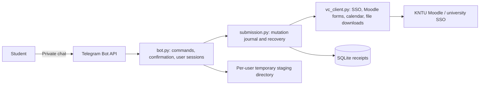
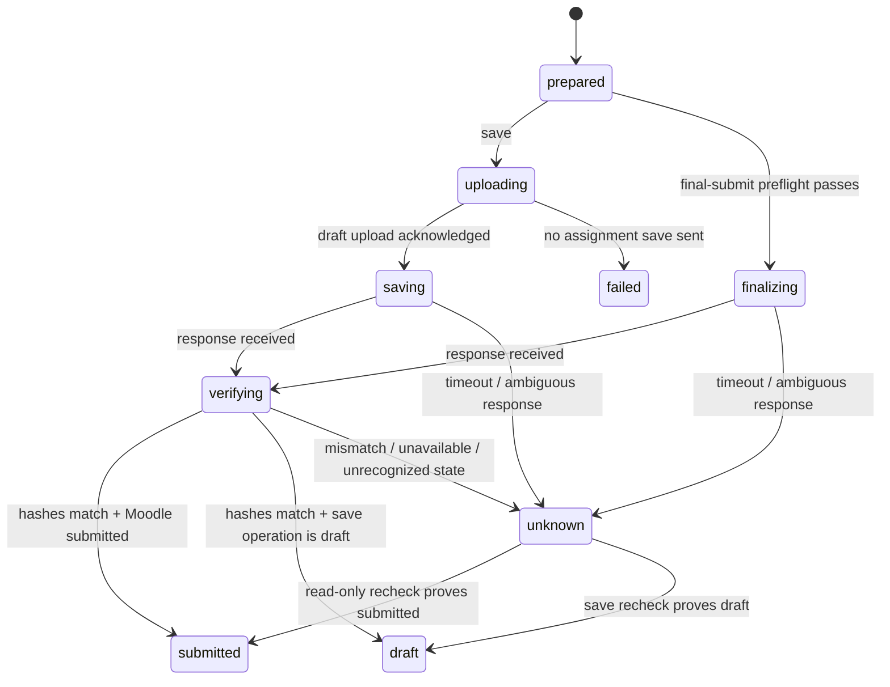

# Architecture and engineering decisions

## The problem

KNTU students use a Moodle portal to find assignments and submit homework. This project moves that workflow into Telegram. Its main correctness risk is an incorrect success message: receiving a document in Telegram, uploading a Moodle draft, saving an assignment and finally submitting it are separate events.

The implementation is intentionally a single Python process. It does not need a queue, distributed workers or an administrator-issued Moodle API token for the current scope.

## Boundaries

| Component | Responsibility | Does not own |
| --- | --- | --- |
| `bot.py` | Private-chat commands, session ownership, document staging, explicit confirmation, receipt formatting | Moodle's submission rules or deadline decisions |
| `ui.py` | Native colored buttons, menus, filtered/paginated lists, compact receipts, escaped HTML and lossless message splitting | Submission state or permission decisions |
| `notifications.py` | Encrypted subscriptions, snapshots, deadline revisions, threshold crossings and persistent delivery outbox | Mutating Moodle submissions |
| `vc_client.py` | Session authentication, form/config parsing, calendar pagination, uploads, download-back hashing, fresh status observations | Telegram users or receipt persistence |
| `submission.py` | Reviewed manifests, durable attempt states, conservative recovery, receipt ownership | Authentication credentials or homework byte storage |
| `demo.py` | Offline HTTP simulation using the real client and receipt service | Evidence that the live university accepts submissions |

## Decision: verify the stored submission, not an acknowledgement

The student's submitted files are selected only from Moodle's submission-status section and `assignsubmission_file/submission_files` links. Teacher attachments cannot count as a student's upload.

Before saving, the service fingerprints the staged documents and any existing submission files. It binds that manifest to the user's confirmation. Before writing, it checks that the staged bytes and current Moodle baseline have not changed. After saving, it:

1. Reads a fresh assignment page.
2. Downloads every student submission file and compares the complete filename set, byte counts and SHA-256 hashes with the expected manifest.
3. Reads the page again and checks that the observed status, file links and last-modified text stayed stable during download.
4. Classifies the result as submitted, draft or unknown.

This costs extra bandwidth and time, especially for existing large files. The tradeoff is deliberate: a false success message is more harmful than a slow confirmation. These checks cannot prove that a remote system will never change afterward, that homework is academically correct, or that hidden server-side state agrees with its web interface.

## Decision: recover ambiguous writes with reads

SQLite records the write stage before the corresponding mutation. If a response is lost, the service performs up to three read-only checks. It never automatically repeats an assignment save or final-submit POST. An unresolved attempt blocks another write to that account/assignment after restart as well.

This is **conservative recovery, not exactly-once delivery**. Moodle does not provide an application-controlled idempotency key here. A permanently unresolved attempt can require manual investigation; the bot deliberately has no automatic override that assumes the first write failed.

## Decision: isolate sessions and receipts by actual account

Sessions are in memory and indexed by Telegram user. Receipts are scoped to both that Telegram ID and a hash derived from the authenticated Moodle user ID, rather than the supplied username/email alias. One user's account cannot retrieve another user's receipts through the bot. Hashing the account ID is pseudonymization, not encryption; receipt filenames and Telegram IDs remain local metadata that the operator must protect.

Credentials entered through `/connect` pass through Telegram's bot infrastructure. Deleting those chat messages does not make the channel end-to-end encrypted. Interactive sessions remain in memory. An explicit background-alert opt-in persists credentials encrypted with Fernet, with a separate local key, and uses independent HTTP sessions. Signing out also disables alerts and deletes that background login. The configured admin's initial subscription uses the existing server configuration, and its `.env` shortcut is restricted to the configured Telegram admin ID.

## Decision: monitor assignment indices, not just the action timeline

The action timeline can omit completed work. The monitor enumerates enrolled courses and reads each course's assignment index, which includes submitted and undated assignments. KNTU's Jalali deadline strings are parsed explicitly and converted to timezone-aware Tehran timestamps. Unknown formats or unavailable courses fail the entire scan; a partial result never overwrites a known complete snapshot. An expected empty-course notice is handled separately from a real error.

A successful scan atomically saves each assignment's identity, deadline and submitted flag, plus pending alerts. Deadline revisions cancel pending alerts from the old schedule and allow reminders for the new deadline. Initial discovery uses one overview; newly detected assignments get individual notifications after that baseline. Submitted, disappeared, overdue and undated work do not receive deadline reminders. Missed threshold crossings after downtime produce only the nearest relevant reminder.

The outbox deduplicates by Telegram user, university account, assignment, deadline revision and alert kind. It retries transient Telegram errors with backoff and disables subscriptions when the bot is blocked. This is at-least-once delivery: an acknowledgement lost after Telegram accepted a message can cause a duplicate. There is no exactly-once notification guarantee. The monitor is a separate asyncio task with independent Moodle clients, never sharing mutable interactive authentication state. It reports repeated scan failures instead of pretending checks are current.

## Decision: report timing evidence without inventing precision

Receipts distinguish client request start, acknowledgement and completed verification. Upload round-trip duration uses a monotonic clock. Moodle's last-modified text, timing status and HTTP Date headers are recorded separately.

Millisecond client timestamps do not reveal the exact instant Moodle committed a submission. Starting an upload before the due date does not prove it was turned in before that date. The server remains responsible for deadline/cutoff enforcement.

## Current constraints

- Updates are processed sequentially, with per-user mutation locks. A large upload or verification can delay other users; no throughput claim is made.
- The Moodle adapter uses institution-specific web endpoints and markup. An SSO or Moodle upgrade may require changes.
- File replacement, existing folders and online-text submissions require the web interface.
- Hosted Telegram transfer limits may be lower than Moodle's file limits.
- Interactive sessions expire after inactivity and are lost on restart. Receipts, alert state and opted-in encrypted background logins survive; staged homework is temporary.
- A credential-free browser authorization flow, rate limits, and broad public-hosting hardening are not implemented.
- Live authentication and read-only portal operations were exercised. Live assignment save/final-submit behavior remains unverified until a disposable assignment is available.
